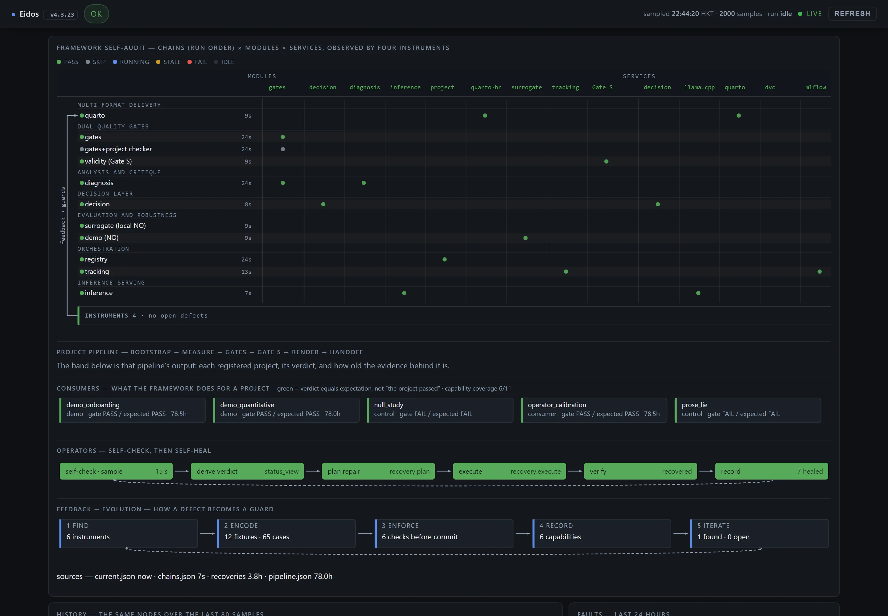
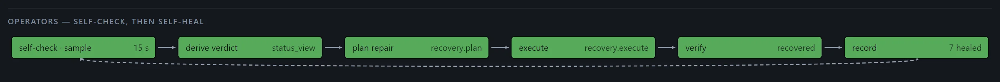
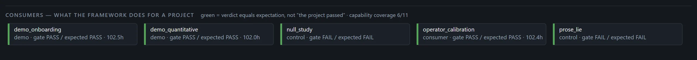
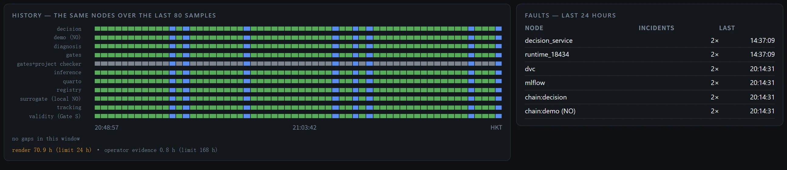
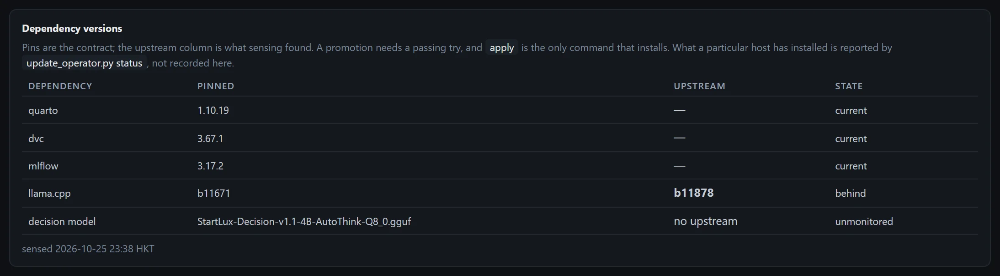

# Eidos — Global Reusable Research Pipeline Framework

**Gate S self-audit: PASS** — 8 objections, 0 open. Five project consumers: three that must pass (`operator_calibration`, `demo_onboarding`, `demo_quantitative`) and two controls that must be rejected (`null_study`, `prose_lie`), plus four chain fixtures. Record: `docs/SELF_AUDIT.json`.

[](https://github.com/Computational-social-science/Eidos/actions/workflows/ci.yml)
[](docs/SELF_AUDIT.json)

**Version 4.2.0** — local-first · model-agnostic · project-agnostic

Quarto + BootLoops + complementary quality gates, including dependency governance

One source → journal LaTeX/PDF + Word + interactive HTML + executable code,
with quantitative and semantic quality gates enforced throughout.

---

## What it looks like

Two surfaces, one palette and one type scale: the document that states what the framework *is*,
and the monitor that watches it *run*. Both are generated from artefacts — `tools/build_site.py`
and `tools/dashboard.py` — so neither can drift into a hand-edited page.

The monitor is the framework auditing itself: eleven chains in run order, the nine modules they
use, the five services those modules reach (Quarto, DVC, MLflow, llama.cpp, the decision
operator), and the instruments that judge the result. Every dot is a verdict, not a decoration.



Under the assembly sit the two loops that make the picture mean something. **Operators** show the
framework checking itself and repairing what it can, with the last attempt coloured by outcome —
an attempt that started is not a repair that held:



**Consumers** are the projects the framework serves, with capability coverage measured rather than
asserted (6 of 11 demonstrated by a consumer, the rest by the framework's own tests). Green means
the verdict matched the expectation, so a negative control doing its job — failing — is green too.
The colour reports the instrument, not the project:



The lower row is history rather than state: the same nodes over the last 80 samples, and the node
incidents that recurred in the last 24 hours — a service that flapped twice is a different fault
from one that died once:



Every image above is regenerated from the built pages by `tools/screens.py --update`, and the
commit hook runs `--check`: if a page changes after its picture was taken, the commit is refused.
The record is `docs/SCREENS.json` (page hashes, image hashes, viewport).

The document carries the declared side of the same picture — the dependency contract, which is
documentation, not live state:



---

## What this is

Eidos is the **global skeleton** every research project inherits. It provides:

| Layer | Contents |
|---|---|
| **Delivery** | Quarto single source → PDF/LaTeX, DOCX, HTML, code artifacts |
| **Quality gates** | BootLoops (quantitative) + Inspect / DeepEval / Promptfoo / Ragas (semantic) |
| **Orchestration** | Eleven chains in a registry (order, dependencies, spans, verdicts), a tiered scheduler and a 15 s sampler that derives one status and drives recovery. No agent graph — `docs/ORCHESTRATION.md` says what was removed and why |
| **Tracking** | MLflow + DVC, optional extras |
| **Diagnosis** | Structured failure reports with root cause, severity, suggested actions |
| **Knowledge** | Agent skills for procedure, each project's `LESSONS` file for history — no vector store |
| **Decision** | StartLux-Decision-4B-Q8_0: typed choice / yes-no / score with calibrated probabilities for routing, gate triage and failure classification |
| **Inference** | Stage-aware scheduling for a 12 GB GPU: one large model resident at a time |
| **Packaging** | One-click Docker/Binder executable package with full provenance |
| **Verifiers (P0–P1)** | `proofpath` decides whether a cited work exists and whether it was retracted; `academic-research-kernel` recomputes p, d, power and CI. Both are model-free, both refuse a claim, and both write an artefact a gate can point at — `docs/VERIFIERS.md` |
| **Model verdicts** | No model gates anything. S4 design judgement measured **0.867** with structured input (bar 0.90), S7 support judgement **0.850** held out — both negative, both with named failure families, both kept out of the gate — `docs/MODEL_VERDICTS.md` |
| **Dependencies** | `pyproject.toml` declares, `uv.lock` pins 294 packages, `update_operator.py` moves a pin only on a passing try. No `requirements.txt` — a third copy drifts |

A new project inherits all of it with one command; only its overrides live in
`projects/<name>/configs/project.yaml`.

### What makes it different from a template repository

| Claim | Mechanism | Evidence you can open |
|---|---|---|
| Gates that can fail | Gate S reads a claim register and checks each claim against an evidence artefact, including the number in the prose | `docs/SELF_AUDIT.json`, `docs/FIXTURES.json` |
| Gate checks that are themselves tested | every check has a fixture that must trip it; mutants that should be rejected are rejected, equivalents that should pass do pass | `tools/fuzz_register.py`, `docs/FUZZ.json` |
| Controls that must fail | two negative consumers ship with the framework and are expected to be rejected | `reference/prose_lie`, `projects/null_study` |
| State that cannot flatter itself | a colour is derived by one function from filed evidence; a stale sample is `STALE`, not the last known PASS | `tools/status_view.py`, `docs/status/current.json` |
| Repairs that report honestly | attempt (process started) and terminal (repair verified) are separate records with a schema | `framework/recovery.py` |
| Pages that are audited like results | paint order, clipping, hit-testing, contrast, type scale, runtime errors — each with a test that builds the defect | `tests/test_layout_guards.py` |
| Dependencies that move on evidence | sense weekly, try in a throwaway environment, promote only on a passing try, roll back from lock history | `lock/versions.lock.json`, `docs/UPDATES.md` |

---

## Installing

```bash
uv sync --extra tracking                 # exact resolved set from uv.lock
# or, without uv:
pip install -e ".[dev,tracking]"
```

`pyproject.toml` says what the project needs, `uv.lock` says what resolved together. There is no
`requirements.txt` on purpose: it would be a third copy that drifts. If a tool insists on a flat
list, generate it — `uv export --no-hashes > requirements.txt` — and never edit it by hand.

---

## Quick start

```bash
# 1. Create a project (inherits every gate, the Quarto pipeline and diagnosis)
make bootstrap PROJECT=my_project      # or: ./bootstrap_project.sh my_project

# 2. Edit the only file that is project-specific
$EDITOR projects/my_project/configs/project.yaml

# 3. Run the pipeline stages
python projects/my_project/scripts/run_experiment.py
python projects/my_project/scripts/run_evaluation.py     # dual gates
python projects/my_project/scripts/build_manuscript.py   # Quarto, all formats
python projects/my_project/scripts/build_package.py      # Docker/Binder

# 4. Render
make render PROJECT=my_project
```

`make` is not installed on every host; `mingw32-make` works, and every target is a
thin wrapper over a documented `python -m ...` command. On a host where bare
`python` is not the interpreter that has the dependencies, pass it explicitly:
`make test PY=C:/Python314/python.exe`.

### Registering an existing repository

One YAML pointer per repository (`projects/<name>/project.yaml`); no files are
copied, and the project keeps its own gates, tests and manuscript pipeline. The
contract, the ownership split and the limits are in `docs/PROJECT_INTEGRATION.md`.

```bash
python -m framework.project list
python -m framework.project check keystroke_observatory
python -m framework.project exec  keystroke_observatory render
```

---

## Repository layout

```text
Eidos/
├── framework/
│   ├── gates/           # BootLoops + semantic gate wrappers
│   ├── diagnosis/       # failure diagnosis engine
│   ├── tracking/        # MLflow + DVC
│   ├── quarto_bridge/   # multi-format render + executable package
│   ├── inference/       # stage-aware model scheduling (12 GB budget)
│   ├── updates.py       # sense / try / promote / roll back dependency pins
│   └── model_ab.py      # twelve fixed questions to two decision-model endpoints
├── lock/                # versions.lock.json — the pinned dependency contract
├── configs/global/      # framework.yaml — the inherited defaults
├── templates/           # project skeleton, Quarto manuscript, executable package
├── protocols/           # BootLoops protocols (submodule)
├── tools/               # BootLoops toolkit (submodule)
├── projects/            # in-tree projects + pointers to external repositories
├── bootstrap_project.sh # project instantiation
└── docs/                # architecture and protocol notes
```

---

## Quality gates

**Quantitative (BootLoops):** `acceptance-gate`, `planted-truth`,
`independence-bookkeeping`, `timing-discipline`, `tool-stewardship`,
`prose-lint`, `ref-check`.

**Semantic:** `inspect` (agent/tool-use), `deepeval` (LLM/RAG unit tests),
`promptfoo` (prompt regression & red-teaming), `ragas` (retrieval quality).

**Human gates (mandatory):** hypothesis confirmation, critical experiment
design, final manuscript submission.

A gate failure is never silent: `framework/diagnosis` produces a structured
report (severity, category, root cause, evidence, suggested actions, estimated
effort) and the pipeline stops unless the failure is auto-retryable.

---

## Dependency governance

Eidos depends on Quarto, DVC, MLflow, the llama.cpp build behind the decision operator, and the
GGUF weights. Their versions move through four separate powers, because the failure mode of a
self-updating system is not that it updates — it is that it updates and cannot say why:

```
sense    python tools/update_operator.py sense      # writes a report; cannot change a pin
try      python tools/update_operator.py try dvc 3.68.0
promote  python tools/update_operator.py promote dvc 3.68.0
apply    python tools/update_operator.py apply dvc   # the only command that installs
```

* **The lock is the contract.** `lock/versions.lock.json` holds one pin per dependency and the
  history of every move; rollback restores from that history rather than from guesswork.
* **A try is evidence, not an opinion.** The candidate is installed into a throwaway `uv`
  environment and probed there: dvc reports its version, mlflow logs a metric to a temporary
  sqlite store and reads it back, Quarto renders a fixture.
* **Promotion needs evidence for that exact version**, recorded within a week, and it refuses to
  move a pin backwards: a try answers *does it work*, not *is it newer*.
* **Weights need behaviour, not a hash.** `framework/model_ab.py` asks twelve fixed questions of
  two endpoints; promotion of the decision model requires agreement ≥ 0.90 and mean |Δp| ≤ 0.05,
  with the endpoint compared against itself as a harness control.
* **A successful promotion bumps Eidos itself** — minor for a forward pin, patch for a rollback.

Sensing runs weekly. It never runs on the pipeline's critical path, and the monitor never shows
pins: declared versions are documentation (`site/index.html`), live state is the dashboard.

---

## Hardware profile

Target: **RTX 4070 (12 GB)**. `framework/inference` keeps a VRAM budget
(default 10.5 GB), loads one large model at a time, unloads between stages, and
maps pipeline stages to models:

| Stage | Models |
|---|---|
| hypothesis / literature | llama3.1:8b, qwen2.5:14b |
| experiment design | qwen2.5:14b, gemma2:9b |
| execution | StartLux-Decision-4B-Q8_0 |
| evaluation / writing | llama3.1:8b, qwen2.5:14b |

---

## Reproducibility

Every delivered package records: git commit, DVC data hashes, MLflow run IDs,
gate logs (quantitative + semantic), Quarto `_freeze` cache, environment
lockfile, and the executable environment (Docker/Binder).

---

## Status and honest limits

- **Tested:** `make test` → **69 tests pass**. They cover both directions of
  every gate (a gate that cannot fail is not a gate), direction-aware acceptance
  criteria, diagnosis severity/actions/redaction with gate details carried into
  the cause, BootLoops root resolution, the project registry's failure modes
  (missing checkout, shell-string command, undeclared command, crash → ERROR), a
  guard that the registry imports no heavy dependency, and the tool-missing
  vocabulary: an absent external tool returns **SKIP** (nothing was examined),
  not a crash and not a FAIL.
- **Chains exercised end to end:** `make audit` → **10 PASS, 1 SKIP, 0 FAIL/ERROR**
  (registry, gates, a project's own checker through `ref-check`, diagnosis naming
  the failed metric, MLflow tracking, a real render of the project's 18-file
  manuscript, inference budget enforcement, and a live decision probe at 182 ms
  median for 2 questions). It found four defects that no import check could see;
  see `docs/CHAIN_AUDIT.md`.
- **Calibrated, not assumed:** `make probe` asks 100 items as a three-way choice; the
  operator answered 50/50 answerable items and declined 50/50 unanswerable ones
  (Fisher p = 2e-29). `none_probability` never exceeded 0.033, so the 0.2 threshold
  from the model authors does not fire here — abstention comes from offering a
  "not stated" option. The confidence floor is *not* identified by this data (no answer
  was ever wrong, so precision is 1.0 at every floor); the probe prints that instead of
  inventing a threshold.
- **Coupling measured, not asserted:** `make coupling` → 10 modules, **1** hard internal
  edge (a tool importing a library), **0** import cycles, 9 of 64 public names consumed
  (14 %). The coupling that does exist is contractual — BootLoops, Quarto, DVC, MLflow and
  three local services — and `make audit` exercises it. See `docs/COUPLING.md`.
- **Contracts snapshotted:** `make contracts` records the identity of each external
  boundary (Quarto 1.10.19, DVC 3.67.1, MLflow 3.17.1, the decision model id, the BootLoops
  root, the runtimes); `make contracts-check` fails only when a boundary that answered
  before has stopped, not when a version changes.
- **CI:** `.github/workflows/ci.yml` runs the suite on 3.11/3.12 and then every chain;
  a chain whose external dependency is absent (no project checkout, no decision
  service) reports SKIP, and only FAIL/ERROR fails the job.
- **First external project registered and exercised:** `keystroke_observatory`.
  `python -m framework.project check keystroke_observatory` → PASS, exit 0,
  `PASS 15  FAIL 0  UNVERIFIED 0`, `GATE: OPEN`; its render command produced
  HTML/DOCX/Typst PDF in 37.6 s. The repository was **not** moved — see
  `docs/PROJECT_INTEGRATION.md`.
- **Bootstrap smoke-tested:** `./bootstrap_project.sh test_project` produced a
  complete project (config, Quarto manuscript, bibliography, four scripts); the
  test project was then removed. `projects/` therefore contains only the
  `keystroke_observatory` registration (a pointer, not a copy).
- **Installed extras on this host (verified by import):** `mlflow-skinny 3.17.1`,
  `dvc 3.67.1`, `inspect-ai 0.3.282`. `deepeval` and `ragas` are **not**
  installed; their gates report a missing-tool failure until a project installs
  them.
- **No memory layer, by decision.** Cross-project knowledge lives in agent
  skills; project-local history lives in the project's own `LESSONS` file. A
  vector store (`framework/memory`) was built, exercised, and deleted because no
  project consumed it — and on this host `chromadb` + `sentence-transformers`
  segfault in one process (`docs/KNOWN_ISSUES.md` §1). The lesson, not the code,
  is what persists.
- The framework is a **skeleton**, not a validated instrument. The gates and
  chains are wired and importable; each project supplies its own metrics,
  datasets and thresholds.
- Gate wrappers shell out to the real tools. If a tool is absent the gate
  reports a failure rather than passing silently.
- BootLoops is **resolved from the shared install**, never vendored. Set
  `BOOTLOOPS_ROOT` if it lives elsewhere; absence raises rather than passing.


## Gate S — scientific validity (claims, not artefacts)

Every gate above checks an artefact. None of them asks whether the sentence the paper
argues for is the sentence the evidence licenses, and a project can pass twenty artefact
gates with an unsupported central claim. Gate S reads `analysis/CLAIMS.yaml` and
re-resolves every handle:

| code | check |
|------|-------|
| S1 | the register parses and has at least one claim |
| S2 | the claim's span appears verbatim in the manuscript |
| S3 | every evidence pointer (RFC 6901) resolves and its value matches the register |
| S4 | `supported` requires a preregistered design **and** a negative control |
| S5 | all five scope axes are declared, or named out of scope with a reason |
| S6 | power and multiplicity are stated and point at an artefact |
| S7 | the referee simulation exists and has no unresolved objection |
| S8 | a claim marked `formal` passes the Lean audit |

```bash
python tools/audit_validity.py --project ../keystroke-observatory
python tools/audit_validity.py --project . --json
```

The Lean chain (`framework/validity/lean_audit.py`) proves four things about a formal
claim: the module builds, `#print axioms` resolves the theorem, the axiom list stays
inside `{propext, Classical.choice, Quot.sound}` with no `sorryAx`, and a control file
asserting `1 = 2` **fails** to compile — if it compiles, the toolchain is not checking
and the axiom report is worthless.

A PASS is not a truth certificate. It means: every claim in the register is in the paper,
every evidence handle still says what the register says, and no reviewer objection is
open. That is the strongest statement a mechanical gate can honestly make.

## The framework audits itself

This framework audits itself: `analysis/CLAIMS.yaml` is read by the same Gate S it
documents, and every number in it comes from `docs/SELF_AUDIT.json`, which is produced by
`tools/record_self_audit.py` rather than typed.

The chain audit runs eleven chains; a missing external checkout is a SKIP, not a pass. The
self-register declares power and multiplicity as not applicable, with the reason stated:
a software deliverable has no sampling error, and pretending otherwise would be the same
category error as reporting a p-value for a build.

Self-audit is also where the framework's own claims can fail. If the recorded chain count
and the register disagree, Gate S refuses the register -- the framework has no exemption
from the rule it applies to projects.

## Demo

`site/index.html` carries the demo inline: three panels (fixed point against parameter,
stability, Newton replay), a checkpoint table, and an out-of-sample panel. It is built by
`tools/build_site.py` from `framework/surrogate/demo.py`, the same operator the gate
audits, and it embeds its data, so it opens from disk with no server and no network.

## Running the monitor

```
python tools/serve_site.py --port 8765      # foreground: / is the monitor, /index.html the document
scripts\install-autostart.cmd               # start at logon, restart on exit (no admin needed)
```

The sampler writes `docs/status/current.json` every 15 s. If it stalls — a blocked probe does not
raise — a watchdog exits the process so the supervisor can start a clean one, and the log says why.
The commit hook and the screenshots keep the page tied to the tree; this keeps it tied to the host.

---

## Delivery page

`site/index.html` is the front door: motivation, architecture, Gate S, live chain status,
the interactive demo and its extrapolation limit, adopters, and the commands that rebuild
it. It is generated by `tools/build_site.py` from the same artefacts the gates read.
