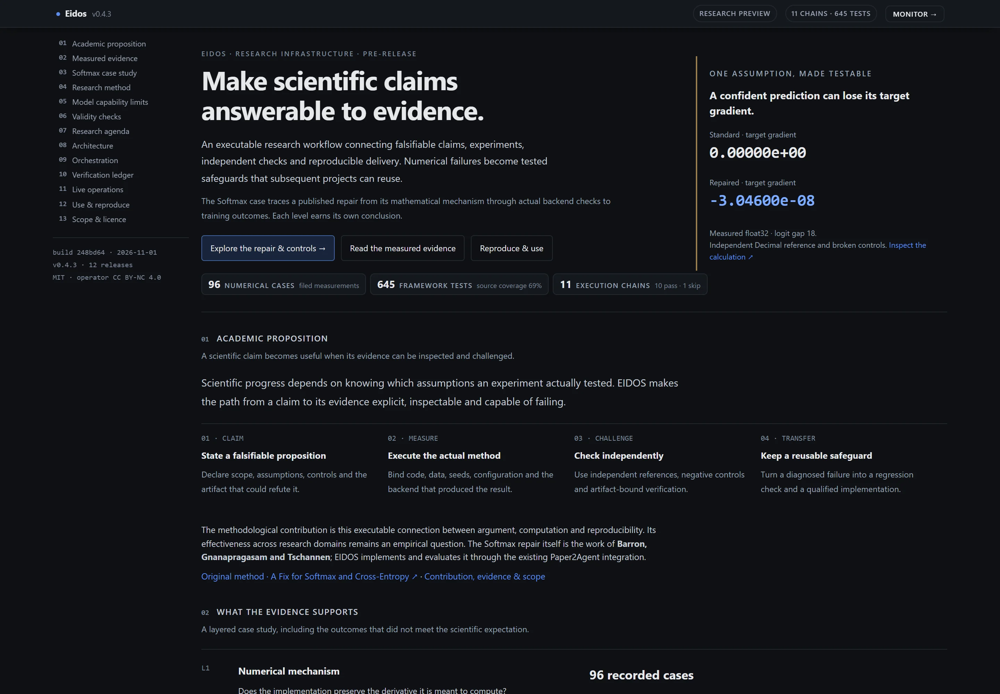

# EIDOS — scientific claims, executable evidence

**Version 0.4.3** · initial development · local-first · MIT framework

[](https://github.com/Computational-social-science/Eidos/actions/workflows/ci.yml)

EIDOS connects falsifiable research claims, experiments, independent verification
and reproducible delivery. Its purpose is to make a result inspectable: what was
assumed, what ran, which checks could reject it, and which conclusion the evidence
supports. Diagnosed failures become reusable checks for subsequent projects.

Start with the [scientific showcase](index.html),
[reproduction instructions](#reproduce-the-measured-case), or
[functional completeness ledger](docs/FUNCTIONAL_COMPLETENESS.md).
The monitor and website serve different jobs: research interpretation belongs on
the website; current execution state belongs in the monitor.



## What has been demonstrated

The current case is **Softmax Collapse and Softmax Cancellation**, based on
[Barron, Gnanapragasam and Tschannen's paper](https://arxiv.org/html/2610.31642v3).
The numerical methods belong to those authors. EIDOS reuses the existing
Paper2Agent conversion and tests the chain from method to scientific conclusion.

| Question | Evidence | Interpretation |
|---|---|---|
| Does the arithmetic preserve the intended derivative? | 96 filed float32/float64 cases, independent Decimal references, actual backend qualification and broken controls | The tested numerical mechanisms are repaired within the qualified scope. |
| Does the implementation affect a system using it? | Saved teacher/student models, equality and parameter-drift checks | A bounded stationarity experiment; numerical correctness and learning outcomes require separate acceptance. |
| Is generalisation consistently improved? | 36 complete trajectories, 18 paired endpoints, independent final-model and gradient checks | Fixed CE is higher in 5 pairs, lower in 12, tied in 1. The paper's training result is not reproduced. All specified seeds and unfavorable outcomes remain available. |

Open the [measurement report](reports/numerics/report.html),
[precision/epsilon matrix](reports/softmax-matrix/report.html),
[paired CSV](reports/softmax-matrix/paired.csv), and
[academic positioning](docs/ACADEMIC_POSITIONING.md).
AMP/bfloat16, higher-order backward and other backends require separate qualification.
These results do not establish universal superiority or autonomous scientific discovery.

## Reproduce the measured case

Prerequisites: Git, [uv](https://docs.astral.sh/uv/) and Python 3.11 or 3.12.
Use a project environment; a GPU and a local language model are not required for
saved-model CPU acceptance.

```bash
git clone https://github.com/Computational-social-science/Eidos.git
cd Eidos
uv sync --locked --extra dev --extra verifiers
uv run --no-sync python -m framework.project check softmax_training
uv run --no-sync python reference/softmax_matrix/verify.py
```

The repository includes measured artifacts and saved models. CPU acceptance
checks those artifacts; it does not rerun CUDA training. Rerunning training needs
the recorded backend/runtime and the case protocol. The qualified CUDA environment
is deliberately separate from the framework's core Python environment.

Standalone case downloads:

- [Numerical kernels and stationarity case](reports/numerics/reproduce.zip)
- [Complete precision/epsilon matrix](reports/softmax-matrix/reproduce.zip)

Both bundles contain checksums and reproduction instructions. Generic Docker/Binder
packaging is still incomplete; the case bundles do not certify the generic packager.
A new-machine installation and an independent project's full lifecycle remain
release acceptance work, tracked in the completeness ledger.

## Reuse EIDOS for a project

```bash
# Discover the safe bootstrap options.
uv run --no-sync python tools/bootstrap_project.py --help

# List existing project registrations.
uv run --no-sync python -m framework.project list

# Run a registered project's own acceptance command.
uv run --no-sync python -m framework.project check PROJECT_NAME
```

A registration points to an existing checkout and declares commands, required
outputs, evidence documents and expected outcomes. Projects retain their own code
and data. A gate that exits successfully without its required artifacts is refused.
Missing tools and unperformed checks retain explicit states.

The reusable research contract is:

1. Register a falsifiable claim, scope and assumptions in `analysis/CLAIMS.yaml`.
2. Declare data/config/code versions, seeds, controls and acceptance criteria.
3. Execute the project and preserve its raw evidence, including unfavorable results.
4. Run independent checks and resolve evidence handles before accepting the claim.
5. Deliver the report, figures, data and executable instructions with provenance.
6. Withdraw cached verdicts when declared inputs change and revalidate them.

See [project integration](docs/PROJECT_INTEGRATION.md),
[actual orchestration](docs/ORCHESTRATION.md) and the
[technical framework](Quarto_Centric_Local_Research_Pipeline_Technical_Framework.md).
The implementation uses deterministic chains and explicit gates; there is no agent graph.

For executable delivery, declare exact input files, a reproduction command, a
validator, required outputs and provenance in the [delivery contract](docs/EXECUTABLE-DELIVERY.md).
The exporter produces a self-contained Python/Docker package; each copy permits
one execution and rejects changed inputs, stale outputs and failed validators.
The [v0.4.2 acceptance capsule](reference/package_delivery_acceptance/package.zip) was
installed in a new Windows environment and replayed in an offline Linux container.
It retains its qualified v0.4.2 source; the v0.4.3 scheduler repair does not change
this numerical delivery probe.
Its [qualification record](docs/PACKAGE-ACCEPTANCE.json) retains image, source and
output hashes, the failed default-registry route and successful official ECR override.
Remote Binder and new-machine/GPU/Quarto qualification remain open.

## Inspect and verify

```bash
uv run --no-sync python -m pytest tests/ -q
uv run --no-sync python tools/audit_chains.py
uv run --no-sync python tools/build_site.py
uv run --no-sync python tools/serve_site.py --port 8765
```

- [Website](http://127.0.0.1:8765/index.html): scientific argument, interactive case and downloads.
- [Monitor](http://127.0.0.1:8765/): services, chains, consumers and recovery evidence.
- [Machine audit](docs/SELF_AUDIT.json) and [health record](docs/HEALTH.md): actual test/coverage counts and scope.

Optional local services can report SKIP or unavailable. A running HTTP server alone
is insufficient health evidence: samples must be fresh and their sequence must advance.
Consumer checks bind registry/configuration, gate source and declared file inputs.
Unknown or changed inputs revoke cached conclusions. Negative controls succeed by
being rejected, while their original evidence stays intact.

Existing Hermes EIDOS jobs use an isolated project interpreter, explicit UTF-8 and
hidden Windows subprocesses. The wrapper removes scheduler import paths from the
whole checker tree and preserves captured errors and exit codes. See
[runtime isolation and real scheduled acceptance](docs/CRON-ISOLATION.md);
manual health checks alone are not scheduler qualification.

The chain audit runs eleven chains; a missing external checkout is a SKIP, not a pass.
This framework audits itself using a valid-register fixture and a mutated control.
These checks establish bounded execution/acceptance behaviour, not scientific novelty.

## Components and boundaries

| Component | Responsibility |
|---|---|
| `framework/project.py` | Typed project registry, command execution, required artifacts and research states |
| `framework/validity/` | Claim spans, evidence pointers, scope, controls and scientific acceptance rules |
| `framework/stable_numerics*.py` | Qualified numerical implementations; independent references live in the verifier |
| `tools/audit_chains.py`, `tools/refresh_chains.py` | Deterministic execution chains, dependencies, scheduling and traces |
| `tools/consumer_snapshot.py`, `tools/watch_pipeline.py` | Input-bound cached verdicts and current observations |
| `tools/serve_site.py`, `tools/monitor_supervisor.py` | Loopback monitor, lifetime ownership, recovery and background verification |
| `framework/quarto_bridge/` | Quarto delivery; external Quarto/TeX installation is required for rendering |
| `framework/executable_package.py` | Explicit delivery manifests, locked installs, exclusive execution and atomic provenance records |
| `tools/publication.py`, `tools/audit_publication.py` | Shared scientific manuscript policy, physical figure/PDF/Word audits and staleness checks |
| `reference/` | Protocols, original evidence, models, controls and existing Paper2Agent tools |

DVC/MLflow tracking and semantic-evaluation adapters are optional. Model-based
scientific judgements by **ScienceRSI-8B (Q4_K_M)** have not met acceptance thresholds: structured S4 accuracy
**0.867** and held-out S7 accuracy **0.850** remain outside scientific gates.
Details: [model verdicts](docs/MODEL_VERDICTS.md).

StartLux-Decision-4B supports bounded typed routing/triage. Experiments run registered
commands; scientific gates use independent verifiers. Legacy Llama/Qwen/Gemma
routing entries are unqualified candidates, and two are absent from this host's
dated inventory. See [task authority](docs/MODEL-TASK-QUALITY.md). No autonomous
research reasoner has been qualified. Scientific generation defaults to blocked;
an explicit draft request never grants scientific authority.

Scientific deliveries follow a [publication quality contract](docs/PUBLICATION-QUALITY.md):
all outcomes, explicit methods/statistical units, independent acceptance, editable
figure masters and data/code availability. Technical checks and complete page
inspection are distinct from human author metadata and journal acceptance.

## Versioning and contribution

The `0.x` series represents initial development. Earlier `v4.x` tags are preserved
as historical numbering; they do not imply a mature production release or SemVer
compatibility with this series. Version migration changes no experimental outcomes.

One release corresponds to one user-visible deliverable. The project version,
editable lock entry, README, website and release record must agree. Original
scientific locks are archived by hash; a changed dependency is not accepted as a
mere version-label change. See [release procedure](docs/RELEASES.md).

Contributions should include a concrete failure case, bounded claims and appropriate
verification. Preserve original evidence and avoid changing acceptance criteria to
fit an observed result. [Known work](docs/FUNCTIONAL_COMPLETENESS.md) is the starting
point for portability, packaging and cross-project evaluation improvements.

## Licence

The framework is MIT. The optional decision model's weights use CC BY-NC 4.0 and
need separate licensing consideration for commercial use. Original methods and
third-party components retain their attribution and licences.
