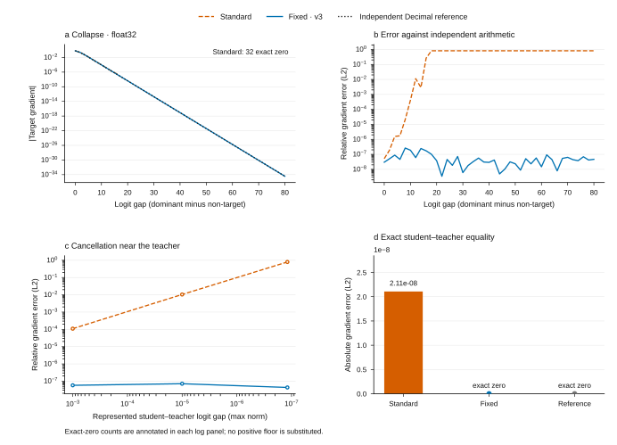
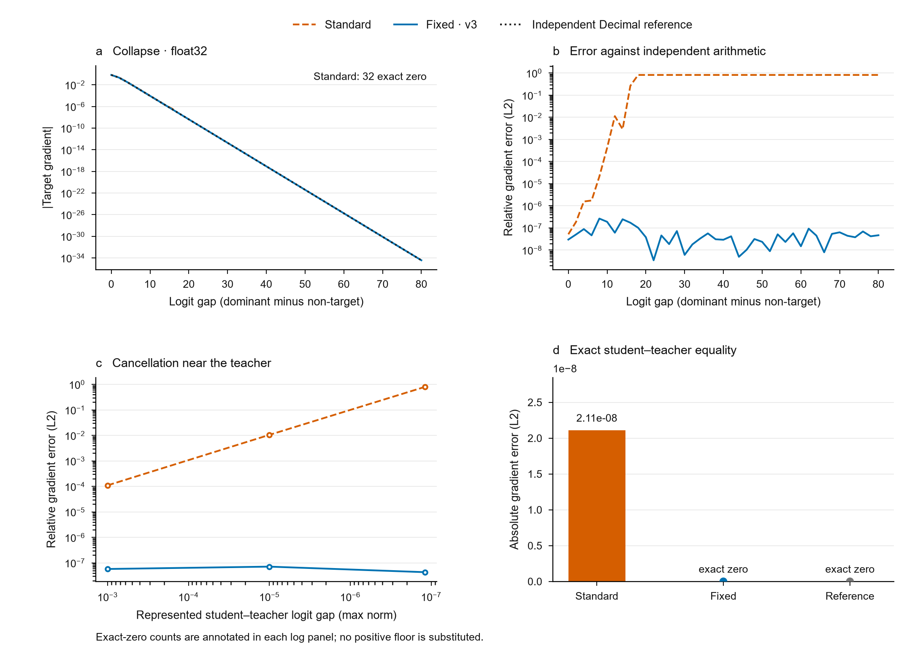

## Scope and research gap

Source: [A Fix for Softmax and Cross-Entropy, v3](https://arxiv.org/html/2610.31642v3).
This reproduces published numerical mechanisms and repairs the existing Paper2Agent integration.
It is not a novel scientific discovery or a reproduction of the paper's training outcomes.

The scientific gap in the source paper is a numerical failure hidden by conventional stability checks: a finite, well-scaled loss can still have an incorrect gradient.
Eidos uses this as an adversarial acceptance case: reproducing a displayed number alone is insufficient.

## Mechanisms

For hard target 0 and $z=(m,0,0)$, the exact target derivative is $-2e^{-m}/(1+2e^{-m})$.
The standard subtraction `q[0]-1` becomes zero after the precision cliff while the other derivatives remain positive. A max shift prevents overflow but does not repair this subtraction.
The fixed forward excludes exactly one argmax before `log1p`; the hard-target backward computes the target derivative as the negative sum of the other derivatives (source Eqs. 5-7).

For distillation, the true gradient is student probability minus teacher probability. Near equal logits this subtraction loses relative accuracy; exact equality should yield zero.
The repair uses centered logit differences, `expm1`/`log1p`, and a zero-sum correction, with the ordinary difference retained for the far branch (source Eqs. 8-9). Teacher logits are required for this contract; already-rounded probabilities cannot recover lost information.

## Reproduction and independent verification

Backend: numpy 2.5.4. Decimal references use represented inputs and adaptive precision.
Eidos 4.3.32; Python 3.12.4. No random seed applies to this deterministic grid.
Source and lock SHA-256 hashes are recorded in evidence.json; bundle checksums cover the shipped source.
The browser selects recorded cases; it does not simulate float32 training.

::: {.content-visible when-format="pdf"}
{width=100%}
:::

::: {.content-visible when-format="html"}
{width=100%}
:::

::: {.content-visible when-format="docx"}
{width=100%}
:::

| Input dtype | Dominant logit | Standard target gradient | Fixed target gradient | Fixed relative L2 error |
|---|---:|---:|---:|---:|
| float32 | 18 | 0.000000e+00 | -3.045996e-08 | 1.019e-07 |
| float64 | 40 | 0.000000e+00 | -8.496709e-18 | 2.078e-17 |
| float64 | 80 | 0.000000e+00 | -3.609703e-35 | 7.001e-17 |

::: {.content-visible when-format="pdf"}
```{=latex}
\newpage
```
:::

## Cancellation and stationarity

| Input dtype | Requested perturbation | Represented perturbation | Standard absolute error | Fixed absolute error |
|---|---:|---:|---:|---:|
| float32 | 0.0e+00 | 0.000000e+00 | 2.107342e-08 | 0.000000e+00 |
| float32 | 1.0e-07 | -1.192093e-07 | 4.950131e-08 | 2.682887e-15 |
| float64 | 0.0e+00 | 0.000000e+00 | 2.775558e-17 | 0.000000e+00 |
| float64 | 1.0e-07 | -1.000000e-07 | 3.861881e-17 | 7.080722e-25 |

## Controls and acceptance

Qualification: **PASS** on 12 cases.
Both deliberately broken controls must be rejected: a lost target gradient and nonzero stationary gradient.
Validation uses relative gradient errors, not an absolute tolerance floor.

## What the Eidos pipeline demonstrates

| Stage | Acceptance evidence |
|---|---|
| Literature to tool | Existing Paper2Agent conversion upgraded; four MCP tools retained, with call traces |
| Independent verification | Decimal definitions over represented inputs; float32/64 dtype preservation |
| Falsification | Collapsed target and stationary-noise controls must be rejected |
| Repeatable delivery | 82 collapse and 14 cancellation cases feed the site, JSON, CSV and this report |
| Reuse | NumPy kernels, optional first-order Torch kernels and a numerical audit in CI |
| Provenance | Locked dependencies, source SHA-256 and a checksummed source bundle |

## Reuse and limits

Use `framework.stable_numerics` for NumPy and `framework.stable_numerics_torch` for optional Torch.
The existing MCP/agent retains four tools and explicitly separates teacher logits from legacy probabilities.
Supported inputs are finite float32/float64; exponent underflow and already-rounded inputs cannot be recovered.
Torch custom loss backward is first-order only; AMP/bfloat16 and higher-order derivatives need separate qualification.
Static screening is heuristic. A passing built-in kernel does not certify a consumer's untested backend.

## Reproduce

```bash
uv sync --locked --extra dev
uv run --no-sync python reproduce.py
uv run --no-sync python -m pytest tests -q
```

The ZIP includes source, lock, tests, evidence, and checksums. JSON and CSV expose every displayed case.

## Optimizer-level before / after

A corrected mechanistic rerun uses trained modular-addition MLP teachers and three declared seeds.
Both students start with identical represented logits; each runs 2000 full-batch Adam steps.

| Seed | Standard final parameter L2 displacement | Fixed final parameter L2 displacement | Teacher held-out accuracy (%) |
|---|---:|---:|---:|
| 0 | 0.17216121 | 0 | 0.07117 |
| 1 | 0.15021692 | 0 | 0 |
| 2 | 0.18160596 | 0 | 0 |

All teachers reached 100% training accuracy but approximately 0-0.0712% held-out accuracy.
This is a stationarity mechanism experiment, not evidence for generalisation or the full paper's training results.
Saved weights independently reproduce the primary endpoint. All seeds, split identities, protocol and model checkpoints are included in the source bundle.
The first run failed because a full-batch teacher cache differed from a training-batch forward. The failed code, evidence and checkpoints are preserved; the corrected run asserts exact initial logit equality.

::: {.content-visible when-format="pdf"}
{width=100%}
:::

::: {.content-visible when-format="html"}
{width=100%}
:::

::: {.content-visible when-format="docx"}
{width=100%}
:::

